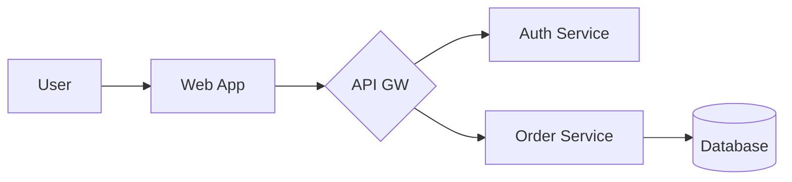
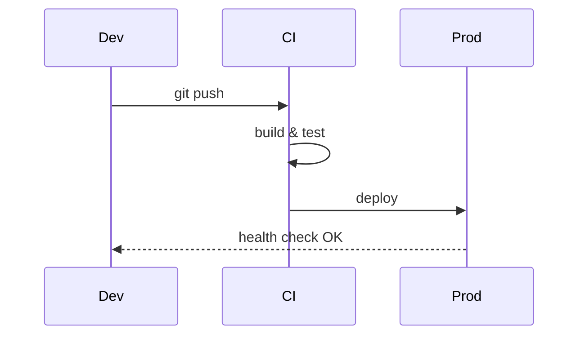

# Release Plan v2.0

A sample document rendered by **MD Browser** — straight from a local `.md` file.

## Overview

| Item | Owner | Status |
|------|-------|--------|
| API freeze | Backend | ✅ Done |
| UI polish | Frontend | 🚧 In progress |
| Docs | Tech writing | ⏳ Planned |

- [x] Feature complete
- [x] Security review
- [ ] Release notes

## Architecture



## Deployment Flow



## Configuration

```ts
export const config = {
  region: 'us-east-1',
  replicas: 3,
  featureFlags: { newCheckout: true },
};
```

## Schedule

### Week 1 — Freeze

### Week 2 — Verification

### Week 3 — Launch
