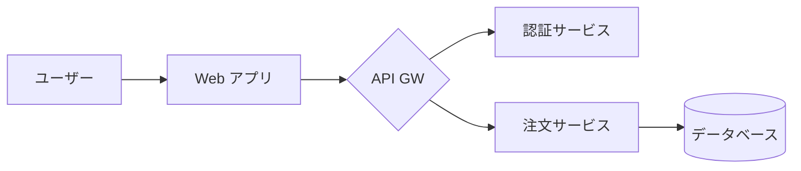
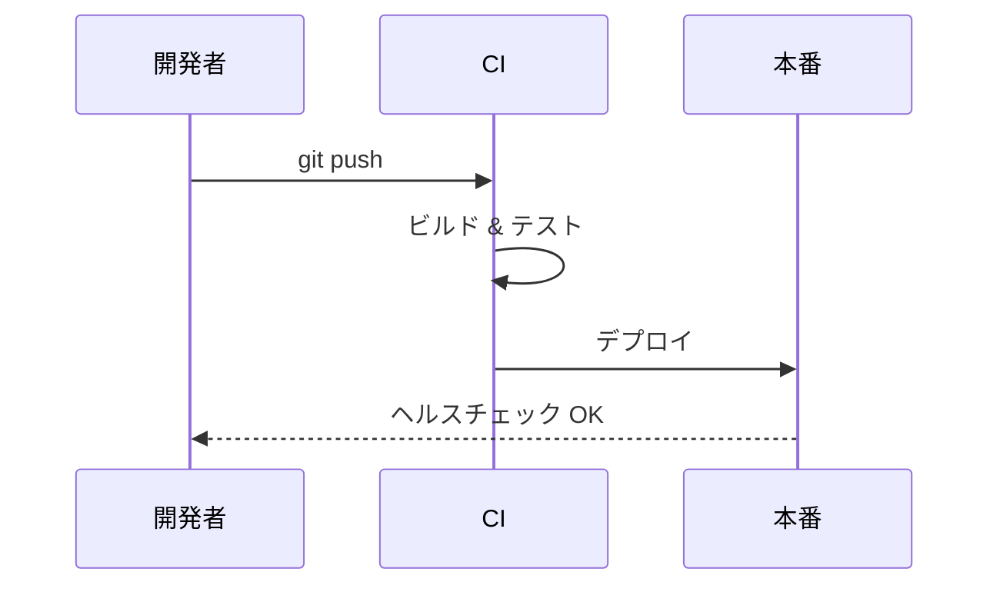

# リリース計画 v2.0

ローカルの `.md` ファイルを **MD Browser** でそのまま表示したサンプルです。

## 概要

| 項目 | 担当 | 状況 |
|------|------|------|
| API 凍結 | バックエンド | ✅ 完了 |
| UI 調整 | フロントエンド | 🚧 対応中 |
| ドキュメント | テクニカルライティング | ⏳ 予定 |

- [x] 機能実装
- [x] セキュリティレビュー
- [ ] リリースノート

## システム構成



## デプロイの流れ



## 設定

```ts
export const config = {
  region: 'ap-northeast-1',
  replicas: 3,
  featureFlags: { newCheckout: true },
};
```

## スケジュール

### 1 週目 — 凍結

### 2 週目 — 検証

### 3 週目 — リリース
