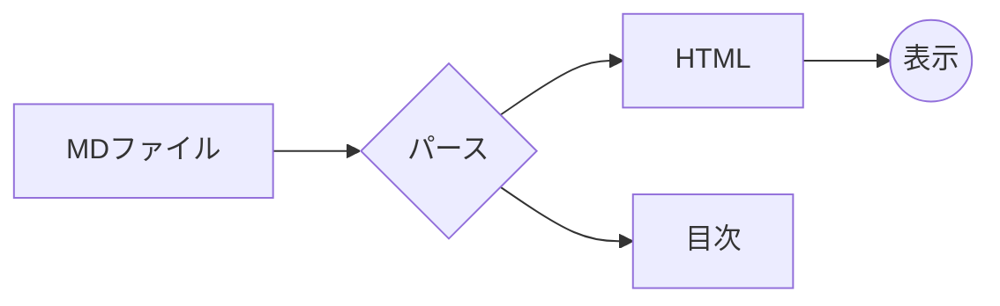
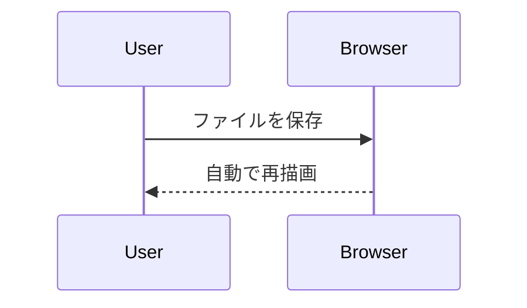
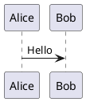

# MD Browser サンプル

このファイルを編集して保存すると、ブラウザ側が自動で再描画されます。

## 基本の書式

**太字**、*斜体*、~~取り消し線~~、`inline code`、[外部リンク](https://example.com)、[別のMDファイル](docs/other.md)

- [x] 完了したタスク
- [ ] 未完了のタスク

| 列A | 列B |
|-----|-----|
| 1   | 2   |

> 引用ブロック

## コードハイライト

```ts
function greet(name: string): string {
  return `Hello, ${name}`; // comment
}
```

## Mermaid





## PlantUML（未対応）



## 画像

相対パス（フォルダを開いたときに表示）:


存在しない画像:


### 深い見出し

#### さらに深い見出し
