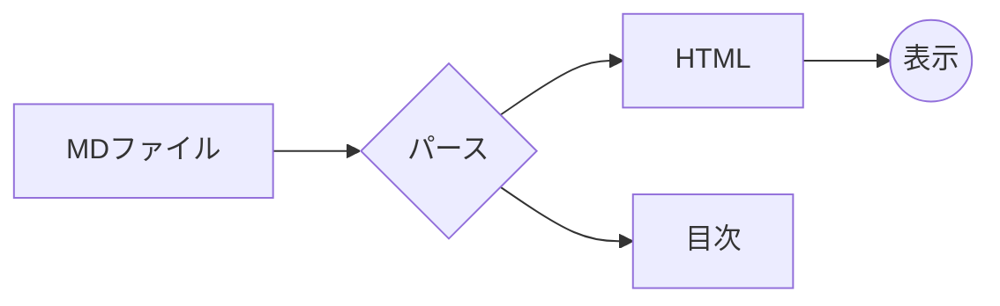
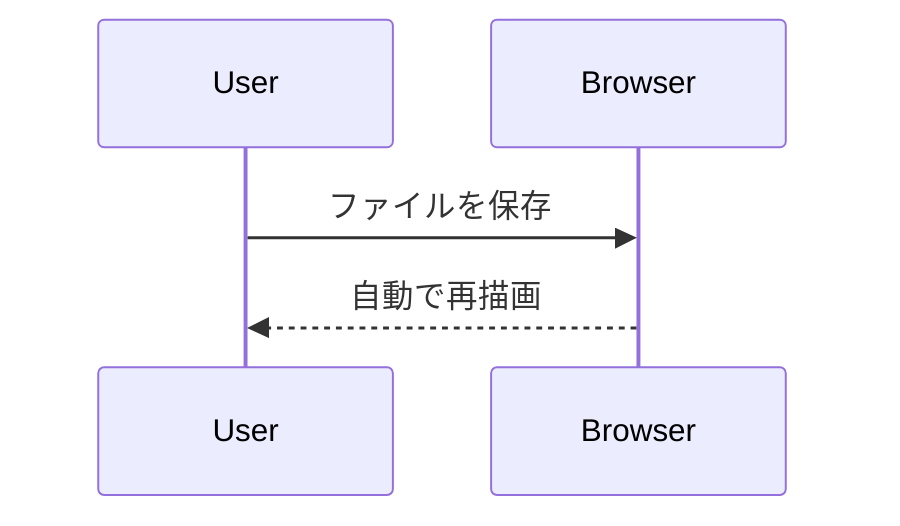
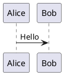
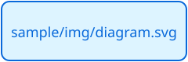

# MD Browser サンプル

このファイルを編集して保存すると、ブラウザ側が自動で再描画されます。

## 基本の書式

**太字**、*斜体*、~~取り消し線~~、`inline code`、[外部リンク](https://example.com)、[別のMDファイル](docs/other.md)

- [x] 完了したタスク
- [ ] 未完了のタスク

| 列A | 列B |
|-----|-----|
| 1   | 2   |

> 引用ブロック

絵文字ショートコード: :tada: :+1: :smile:

## アラート

> [!NOTE]
> 補足情報。流し読みでも目を通してほしい内容。

> [!TIP]
> 知っていると便利なこと。

> [!IMPORTANT]
> 目的の達成に必要な情報。

> [!WARNING]
> 問題を避けるため、すぐに注意が必要な内容。

> [!CAUTION]
> 操作によって起こりうる悪影響。

## 脚注

脚注はページ末尾にまとまります[^1]。名前付きの脚注[^note]も使えます。

[^1]: 脚注の本文。末尾の矢印で本文に戻れます。
[^note]: 名前付きラベルでも番号は出現順に振られます。

## コードハイライト

```ts
function greet(name: string): string {
  return `Hello, ${name}`; // comment
}
```

## Mermaid





## PlantUML（未対応）



## 画像

相対パス（フォルダを開いたときに表示）:



アニメーション GIF:


存在しない画像:


### 深い見出し

#### さらに深い見出し
