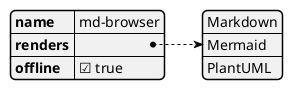
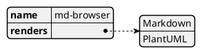
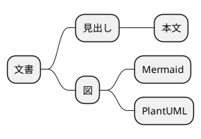
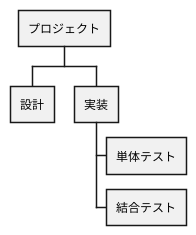
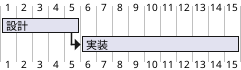

# PlantUML の図の種類

同梱のエンジン（Smetana レイアウト）で描ける図の例。`@start…` の行で種類を選ぶ。

## JSON



## YAML



## マインドマップ



## WBS（作業分解）



## ガントチャート



## 標準ライブラリ（取得先を設定したときだけ）

`!include <C4/…>` などの標準ライブラリは同梱していない。表示設定（⚙）の「PlantUML」でライブラリの取得先を指定すると、図が include したライブラリだけを取得して描く。指定がなければ、このブロックはエラー表示になる。

```plantuml
!include <C4/C4_Context>
Person(user, "利用者")
System(md, "MD Browser")
Rel(user, md, "読む")
```
